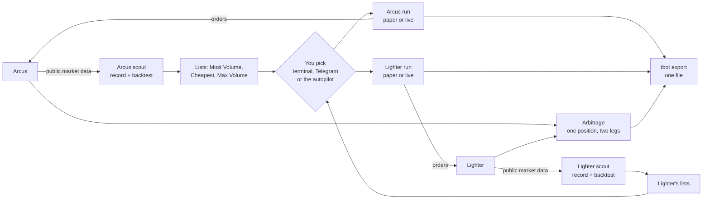

# treading-bot

Three maker (limit-order) bots for perpetual futures, and two strategies beside them. The bots' aim is as much **maker
volume** as possible at the lowest cost per dollar traded. All five share one install, one `.env`, one Telegram chat
and one start command.

| Bot | Folder | Terminal | Telegram | What it does | Guide |
|---|---|---|---|---|---|
| **Arcus** | [`arcus/`](arcus) | `arcus …` | `/status`, `/run` … | Quotes both sides of one Arcus perp at a time | [arcus/README.md](arcus/README.md), [RUNBOOK](arcus/RUNBOOK.md) |
| **Lighter** | [`lighter/`](lighter) | `lighter …` | the same with `l_`: `/l_status`, `/l_run` | The same setups on Lighter (Robinhood Chain), a zero-fee venue | [lighter/README.md](lighter/README.md) |
| **Arbitrage** | [`arbitrage/`](arbitrage) | `arbitrage …` | `/arb_status`, `/arb_scan` … | Short the venue that pays more funding, long the other, equal size | [arbitrage/README.md](arbitrage/README.md) |
| **Daytrade** | [`daytrade/`](daytrade) | `daytrade …` | `/dt_status`, `/dt_trades` | SPY, QQQ and gold strategies, each with its own backtest, and a paper bot | [daytrade/README.md](daytrade/README.md) |
| **Delta neutral** | [`deltaneutral/`](deltaneutral) | `deltaneutral …` | `/dn_status`, `/dn_transfer` … | Two markets, long on one venue and short on the other, renewed every 24 hours | [deltaneutral/README.md](deltaneutral/README.md) |

Where each stands (October 2026):
- **Arcus:** traded live with real money; the backtest matched the largest live run on cost.
- **Lighter:** live-tested on 2026-10-10 at the smallest size (a ten-minute run that ended flat). Not yet run for hours.
- **Arbitrage:** paper for the whole executor. Its Lighter leg passed a real-money test; its Arcus leg and the two-leg
  engine have never run live. The live switch is off.
- **Daytrade:** paper only; it has no live mode. Only buying short dips in SPY and QQQ passed its backtests.
- **Delta neutral:** built 16 Oct 2026, paper only so far; its 30-day backtest lost money on every pair.

> **Risk warning.** Experimental software that can place real orders with real money. Backtests are estimates, not
> promises. Nothing here is financial advice. Run paper first, then small, and only with money you can lose.

**The five commands** (every command in this guide runs from `treading-bot/arcus`):

```bash
.venv/bin/tbot up                  # start everything this machine is for
.venv/bin/tbot status              # one status screen
.venv/bin/arcus pilot approve 1    # run the best Arcus setup on paper
.venv/bin/arcus pilot close        # close it
.venv/bin/tbot export              # pack everything recorded and traded into one file
```

`tbot` is for what belongs to the whole machine; each bot starts and stops only itself:

| To | Command |
|---|---|
| Start everything this machine is for | `tbot up` |
| Start one part | `arcus up`, `lighter up`, `tbot up telegram`, `tbot up daytrade`, `tbot up deltaneutral` (paper; only when named); both scouts and nothing else: `tbot scout` |
| Stop | `arcus down`, `lighter down`, `tbot down [parts]` (`--all` also stops the runs; positions are kept) |
| Look | `tbot status` (the machine), `arcus status`, `lighter status`, `arbitrage status` |
| Say what this machine is for | `tbot role` shows it; `tbot role trader` (or `recorder`, `scout`, `all`) sets it |
| Export, import, sync, recommend | `tbot export`, `tbot import`, `tbot sync`, `tbot recommend` |

In Telegram they are all spelled alike: `/arcus_status` (or `/a_status`, or the bare `/status`), `/l_status`,
`/arb_status`, `/dt_status`, `/dn_status`.

**Contents:** [1 How it fits together](#1-how-it-fits-together) · [2 Install](#2-install) ·
[3 Run it on a server](#3-run-it-on-a-server) · [4 Export and import](#4-export-and-import) ·
[5 The commands, by what you want to do](#5-the-commands-by-what-you-want-to-do) ·
[6 Troubleshooting](#6-troubleshooting) · [7 Development](#7-development) ·
[8 Where everything lives](#8-where-everything-lives)

---

## 1. How it fits together



The loop is: **record → backtest → rank → you pick → run → export → analyse → refine.**

| Process | Started by | What it does | Needs keys |
|---|---|---|---|
| Arcus scout | `tbot up`, `arcus up` | Records every Arcus perp (best bid/offer, trades, top-10 depth). Every 30 min it backtests 8 setups on every market, ranks them, checks the running setup and runs the autopilot | no |
| Lighter scout | `tbot up`, `lighter up` | The same for every Lighter perp (36 setups) | no |
| Telegram bot | `tbot up`, when the token is in `.env` | The one chat that controls every part and posts alerts | the token |
| Guardian | by itself, with a live Arcus run | A separate process: cancels everything if the live bot is silent for 60 s | yes |
| A run (Arcus, Lighter) | you (`/run`, `/l_run`, `pilot approve`) or an autopilot | Trades one setup on one market | live only |
| Arbitrage executor | you (`/arb_start`, `arbitrage start`) | Holds one position across both venues | live only |
| Daytrade paper bot | `tbot up` where `BOT_ROLE` is `all` or `trader`, `tbot up daytrade` | Replays its strategies on Lighter's prices; sends no orders | no |
| Delta-neutral bot | you (`tbot up deltaneutral`, `/dn_start`, `deltaneutral start`) | Two markets across both venues, one cycle a day | live only |

The rules that hold everywhere:
- **Paper is the default:** live market data, simulated orders, the same code as live.
- **Live needs three things:** a switch in `.env`, a passing `doctor`, and a typed confirmation.
- **One market-making setup per venue at a time.** Starting another closes the first.
- **Stopping is not closing:** *stop* cancels the quotes and keeps the position; *close* also closes the position.
- **The backtest and the live bot share their rules:** sizes, stops and quotes come from the same code.
- **Settings are changed with commands** (`/set`, `/l_set`, `/arb_set`, or the terminal), never by editing files.

---

## 2. Install

Needs macOS or Linux, Python 3.12 and [uv](https://docs.astral.sh/uv/) (`brew install uv`, or
`curl -LsSf https://astral.sh/uv/install.sh | sh`). On a fresh Ubuntu server use [section 3](#3-run-it-on-a-server).

```bash
git clone https://github.com/dhruvamity/treading-bot.git
cd treading-bot/arcus
make install                       # one environment (arcus/.venv) with every part
cp .env.example .env && chmod 600 .env
.venv/bin/arcus doctor             # reads only: says what is missing
.venv/bin/tbot up                  # both scouts, and Telegram if its token is in .env
```

Recording, backtests and paper need **no keys at all**. A market appears in a list after about 3 full recorded UTC
days; `/run`, `/l_run` and the arbitrage work at once, because they never wait for a scan.

**Credentials** (`arcus/.env`; fill in only what you use, never commit it; `arcus keys` shows what the venue sees):

| Variable | What it is | Needed for |
|---|---|---|
| `ARCUS_ADDRESS`, `ARCUS_API_PRIVATE_KEY` | Your wallet address and an Arcus API key (Arcus web app → API Keys) | Arcus live, `doctor`, balance |
| `TELEGRAM_BOT_TOKEN`, `TELEGRAM_CHAT_ID`, `TELEGRAM_ALLOWED_USER_IDS` | From @BotFather; your chat id; the only users who may send commands | Telegram |
| `BOT_PILOT_LIVE=1` | Allows live Arcus runs | Arcus live |
| `LIGHTER_ADDRESS`, `LIGHTER_API_PRIVATE_KEY`, `LIGHTER_API_KEY_INDEX`, `LIGHTER_ACCOUNT_INDEX` | The Lighter key ([lighter/README.md](lighter/README.md), section 2) | Lighter live |
| `LBOT_LIVE=1` | Allows live Lighter runs | Lighter live |
| `ARB_LIVE=1`, `ARCUS_ACCOUNT_INDEX` | Allows the live arbitrage; the Arcus subaccount it uses | arbitrage live |
| `DN_LIVE=1` | Allows the live delta-neutral bot (it reads `ARCUS_ADDRESS`, `ARCUS_ACCOUNT_INDEX`, `LIGHTER_ACCOUNT_INDEX` too) | delta neutral live |
| `PROFUNDING_API_KEY` | ProFunding's data key (read-only; never give it an exchange key) | the arbitrage, when ProFunding decides the side or the market |
| `BOT_ROLE` | What this machine is for: `all` (default), `trader`, `recorder`, `scout` | [two machines](#two-machines-one-records-one-trades) |
| `BOT_SYNC_FROM`, `BOT_SYNC_KEY` | On a trader: `user@host` of the machine that makes the lists, and the key file it fetches with | a trader that fetches lists |

**Telegram** (optional, once):
1. Message **@BotFather**, send `/newbot`, and put the token in `TELEGRAM_BOT_TOKEN`.
2. Send your new bot any message, open `https://api.telegram.org/bot<TOKEN>/getUpdates`, and put `chat.id` in
   `TELEGRAM_CHAT_ID`.
3. `tbot up`, send `/whoami`, put your user id in `TELEGRAM_ALLOWED_USER_IDS`, then `tbot down` and `tbot up`.

Then `/menu`, `/status`, `/l_status`, `/arb_status`. Next: [section 5](#5-the-commands-by-what-you-want-to-do), or
[arcus/README.md](arcus/README.md) section 2 for zero to a live run.

---

## 3. Run it on a server

A server records around the clock and trades while your laptop is off.

**One machine for everything:** Ubuntu 24.04, 4 or more cores, 8 GB of memory, and disk for the recording (about
0.3–0.5 GB a day for both venues). It must be in a region Arcus allows.

```bash
git clone https://github.com/dhruvamity/treading-bot.git
cd treading-bot/arcus
bash deploy/scripts/bootstrap.sh   # installs, syncs the clock, firewall (SSH only), .env, `tbot up` after a reboot
nano .env                          # or from your computer: scp arcus/.env USER@SERVER:treading-bot/arcus/.env
.venv/bin/arcus region-check       # must say OK for Arcus perps
.venv/bin/arcus doctor
.venv/bin/tbot up
```

The script starts nothing and is safe to run again. It has been syntax-checked but **not yet run on a real server**:
read its five steps as they print.

- **Every day:** `.venv/bin/tbot status` (or `/status`, `/l_status`, `/arb_status`), and `df -h`.
- **Update:** `git pull && make install && .venv/bin/tbot down && .venv/bin/tbot up`. `tbot down` leaves a running
  trade alone.
- **Gaps cannot be refilled.** Neither venue serves old order books: what the recorder misses is gone.
- **Disk:** the recorders pause under 5 GB free, and nothing deletes old tape by itself.
- **After a reboot** `tbot up` comes back by itself; **the arbitrage executor does not** (start it again with
  `/arb_start`; it picks its position up from its files).

### Two servers, step by step: one records, one trades

One small server cannot record, rank and trade at once (the two recorders took about 210 MB; one backtest of the
busiest market's day peaked at 664 MB). Two Ubuntu 24.04 servers with 1 vCPU and 1 GB each are enough: the **recorder**
needs disk (10–15 GB a month) and no keys; the **trader** holds the keys and must be in a region Arcus allows.

**A. On both servers.** A 1 GB machine gets a swap file first:

```bash
sudo fallocate -l 2G /swapfile && sudo chmod 600 /swapfile && sudo mkswap /swapfile && sudo swapon /swapfile
echo '/swapfile none swap sw 0 0' | sudo tee -a /etc/fstab
git clone https://github.com/dhruvamity/treading-bot.git
cd treading-bot/arcus
bash deploy/scripts/bootstrap.sh
```

**B. The recorder** (no keys go on this machine):

```bash
.venv/bin/tbot role recorder       # writes BOT_ROLE=recorder into .env
.venv/bin/tbot up                  # both recorders; no scans, no Telegram, no trading
.venv/bin/tbot status              # "THIS MACHINE: recorder"; the rows climb
cat data/scout/recorder.json       # last_msg_age_s a few seconds, paused_for_disk false
```

**C. The trader.** Put your keys in `.env` first ([section 2](#2-install); leave the three live switches empty for
paper), then:

```bash
.venv/bin/tbot role trader         # writes BOT_ROLE=trader into .env
.venv/bin/arcus region-check       # must say OK for Arcus perps
.venv/bin/arcus doctor             # keys, account and clock; reads only
.venv/bin/tbot up                  # the Telegram bot and the runs' guardian; no recording, no scans
.venv/bin/tbot status              # "THIS MACHINE: trader"
```

Check that the role took: `tbot up` prints `this machine: trader` first, and its `scout: started …` line ends
`[this machine is a trader: …]`, not `[always]`. If not: `tbot down`, `tbot role trader`, `tbot up`.

**D. From the phone**, in the trader's Telegram chat: `/whoami`, `/status`, `/l_status`, `/arb_status`, then a paper
run of each bot:

```
/run SPY smart 0 50x paper
/l_run SPY smart +1 50x paper
/arb_lev max max SPY
/arb_cycle 3
/arb_start 120 120
```

**E. Bring the recording home** every few days, for backtests and for the setups worth running. On the recorder
`tbot export` prints the file and the `scp` line; on your own computer, from `treading-bot/arcus`:

```bash
scp USER@RECORDER:treading-bot/exports/tb-XXXX.tar ~/Downloads/
.venv/bin/tbot import              # must end "N complete, 0 short"
.venv/bin/arcus recommend --scan   # scans both bots; prints the best setups as lines to paste into Telegram
```

`recommend SPY QQQ` narrows it to markets, `--list cheapest` (or `volume`, `max`) to one list, `--capital 500` ranks
for the money the trader holds. The scan is made as of the end of the recording, so export fresh before acting on it.

**F. Let the trader watch the recorder** (optional: `⚠️ TWO MACHINES` in Telegram when the recorder goes quiet):

```bash
.venv/bin/tbot sync key                                       # on the trader: prints one line, ssh-ed25519 …
.venv/bin/tbot sync allow 'ssh-ed25519 AAAA… treading-bot-sync'   # on the recorder: that line, in quotes
echo 'BOT_SYNC_FROM=USER@RECORDER-ADDRESS' >> .env            # back on the trader
.venv/bin/tbot sync pull && .venv/bin/tbot sync status && .venv/bin/tbot down && .venv/bin/tbot up
```

### Two machines: one records, one trades

`BOT_ROLE` in each machine's `.env` decides what `tbot up` starts there. Every part follows it.

| `BOT_ROLE` | Records the tape | Ranks (scans, playbook) | Telegram, runs, arbitrage | Keys | Fits |
|---|---|---|---|---|---|
| `all` (default) | yes | yes | yes | yours | 4 cores, 8 GB |
| `trader` | no | no | yes | yours | 1 core, 1 GB |
| `recorder` | yes | no | no | none | 1 core, 1 GB plus disk |
| `scout` | yes | yes | no | none | 4 cores, 8 GB |

- **The keys live on the trader only.** A recorder or scout refuses every run and never starts the Telegram bot.
- **A trader needs nothing from the other machine to trade:** `/run`, `/l_run`, the arbitrage, the stops and the
  guardian all work with the recorder switched off.
- **What a trader lacks is the lists** (`/top3`, the pilot's picks, both autopilots): they come from the tape. Either
  scan at home and paste the lines (step E), or hand the lists over: `arcus scout scan`, `arcus scout playbook`,
  `tbot sync push USER@TRADER` from your computer; or run a `scout` machine and let the trader fetch them by itself
  (step F with the scout's address; it then pulls about every two minutes). An old Arcus list is a warning; Lighter
  refuses a pick from a scan over 90 minutes old.
- **The link is one-way and narrow.** The trader asks; nothing ever logs in to the trader. Its key can run one command
  on the other machine (`tbot sync serve`: a fixed list of small files, no shell). A broken-into recorder could hand
  over wrong lists, nothing more: sizes and stops are worked out on the trader, and a live run still needs you.
- **Not yet run between two real servers** (checked on one computer, each role in its own folder, 2026-10-10). On
  the first day watch `tbot status` and `free -m` on both and `tbot sync status` on the trader.

**A 1 GB server (for example Azure's free `Standard_B1s`).** One such VM runs free all month, a second one is paid.
Pick a region Arcus allows and run `arcus region-check` before anything else. Add the swap file, set `BOT_ROLE=trader`
(the default `all` would start recorders and scans, which 1 GB cannot hold), and never scan or backtest on it. The
arbitrage alone runs on it: one light process that needs no recorder; its stop orders rest on the venues, so a dead VM
does not leave a naked position, but nothing watches the holding rules until you start it again. To have it come back
by itself after a reboot, add this to the crontab, knowing that `--yes` skips the typed `LIVE` and that a flat
executor may open a position on its own:

```
@reboot sleep 60 && cd $HOME/treading-bot/arcus && .venv/bin/arbitrage start --live --yes >> logs/boot.out 2>&1
```

**A machine that only records (Docker).** From `arcus/` (container `arcus-scout`) or `lighter/` (`lighter-scout`):
`docker compose up -d --build`, then `cat data/scout/recorder.json`. `BOT_ROLE=recorder docker compose up -d` records
without scanning; the other options are at the top of each `docker-compose.yml`. Bring its data home with
`docker compose exec scout tbot export --out data/exports`. **Never use Docker on a machine that trades:** a container
cannot see a native bot's process.

---

## 4. Export and import

One command on the server packs the recordings, the trades, the state and the logs of all three bots into one file;
one command at home takes it in.

```bash
.venv/bin/tbot export              # on the server: prints the file (exports/tb-<date>-<time>Z.tar) and the scp line
.venv/bin/tbot import              # at home, with the file in exports/ or ~/Downloads: must end "N complete, 0 short"
```

Then read `arcus/data/server-export/<name>/SUMMARY.md` first: the status screen, fills by day and market, runs and
their cost, warnings and crashes, how complete the recording is.

| Command | What it packs |
|---|---|
| `tbot export` | Everything **new since the last export** (the first time: everything) |
| `tbot export --full` | Everything again (also how to seed a new server) |
| `tbot export --days 2`, `--since 2026-10-01` | All state and trades, the logs and tape of those UTC days |
| `tbot export --no-tape` | State, trades and logs only: a quick error report, a few MB |
| `tbot export --tag tokyo`, `--out /mnt/disk` | A word in the name; another folder |

- **Never in it:** `.env`, `config/secrets.enc`, pid files; every secret value is blanked out of the logs and
  database copies. It does hold your trading history and wallet address, so do not post it.
- **Safe while trading:** it only reads. It refuses to take the disk under 6 GB free and keeps the newest 3 files.
- **Import never touches this machine's own state or logs.** The tape is merged; a file already there is kept.
- **Missed one?** Each plain export holds only what is new: import the one before it too, or use `--full`.
- **Not in it yet:** daytrade and delta neutral. Their state is small: copy `daytrade/state/` and
  `deltaneutral/state/` by hand (`scp -r`).

---

## 5. The commands, by what you want to do

`.venv/bin/arcus`, `.venv/bin/lighter`, `.venv/bin/arbitrage`, `.venv/bin/daytrade` and `.venv/bin/deltaneutral` are
the programs; the same jobs are `/…`, `/l_…`, `/arb_…`, `/dt_…` and `/dn_…` in the one Telegram bot. Each part's own
guide has the detail.

### Arcus

| I want to | Terminal | Telegram |
|---|---|---|
| See the lists | `cat data/scout/report.txt` · `arcus pilot status` | `/top3`, `/cheapest`, `/maxvolume` |
| Run the #1 setup on paper | `arcus pilot approve 1` (`--list cheapest` or `max`) | ▶️ on a list |
| Run my own pick | `arcus run SESSION` (a file in `config/sessions/`) | `/run SPY smart 0 50x paper` |
| Watch it | `arcus dashboard` | `/dashboard`, `/status`, `/positions`, `/orders` |
| Stop, keep the position | `tbot down --all` | `/stop` |
| Close the position and stop | `arcus pilot close` | `/closeall` (typed code) |
| Cancel every order / close every position now | `arcus cancel-all --venue arcus` · `arcus flatten --venue arcus` (`--taker`) | `/cancelall` · `/closeall taker` |
| Yesterday's result | `arcus report --date 2026-10-09` | `/yesterdayreport` |
| Trade again after a safety stop | `arcus resume --venue arcus` | `/resumeaftersl` |

A run's limits go on the same line: `/run BTC mid 0 40x live sl=10 tp=5 vol=100k` may lose $10, and stops once up $5
or after $100,000 of volume. Setups are `mid`, `smart` or `grid`, a spread in bp, and optionally `long` or `short`.

**Live** (real money; [arcus/README.md](arcus/README.md) section 2 has the reasons):

```bash
.venv/bin/arcus selftest                 # while the account is empty: every line PASS or INFO
echo 'BOT_PILOT_LIVE=1' >> .env          # after depositing USDG into the subaccount the key is bound to
.venv/bin/tbot down && .venv/bin/tbot up
.venv/bin/arcus doctor pilot             # must end in READY
.venv/bin/arcus pilot approve 1 --live   # prints the doctor's lines, then you type LIVE
```

From the phone: `/run SPY smart 0 50x live sl=10`, then type back the 6-digit code. Keep `sl=` small at first.

### Lighter

The same ideas on a zero-fee venue (the bot's cost is the spread). [lighter/README.md](lighter/README.md) has the rest.

| I want to | Terminal | Telegram |
|---|---|---|
| Markets and lists | `lighter markets` · `lighter status` | `/l_top3`, `/l_cheapest`, `/l_maxvolume` |
| Paper run, my pick | `lighter run SPY "smart +1"` (`--bg` for the background) | `/l_run SPY smart +1 50x paper sl=10` |
| Paper run, list #1 | `lighter pilot approve 1` | ▶️ on a list |
| Pause or resume new orders | `lighter pause` · `lighter unpause` | `/l_pause` · `/l_unpause` |
| Stop (keep the position) / close | `lighter stop` · `lighter close` | `/l_stop` · `/l_closeall` |
| Test one backtest by hand | `lighter backtest SPY "smart +1" --capital 100` | |

**Live.** The key is registered on **your own computer**, never on a server (it asks for the wallet's private key once
and does not store it):

```bash
.venv/bin/python ../lighter/scripts/register_key.py --slot 4    # prints three lines for .env
echo 'LBOT_LIVE=1' >> .env               # after depositing USDG in the Lighter app
.venv/bin/lighter doctor SPY             # READY, and "account tier" must say standard (0% fees)
.venv/bin/lighter livetest               # real money, cents: every request the bot sends, once; you type LIVE
.venv/bin/lighter run SPY "smart 0" --lev 2 --capital 16 --live --sl 1 --seconds 600 --flat   # the smallest real run
```

### Arbitrage (funding between Arcus and Lighter)

One position: short where funding pays more, long on the other venue, the same size. It needs money on **both**
venues and none of the recorders, trades stocks, indices and commodities only, and is held for days (a position needs
about two days of funding to pay for its fills). The owner's mode instead renews SPY at the venues' highest leverage
every three funding payments, which buys volume and open interest and **costs** about $35 per $1M traded.
[arbitrage/README.md](arbitrage/README.md) has the numbers, the rules and every command.

```bash
.venv/bin/arbitrage scan                               # ranks the markets with your accounts' free collateral
.venv/bin/arbitrage plan SPY --arcus 120 --lighter 120 # what it would open now: side, leverage, size, stop
.venv/bin/arbitrage lev max max SPY                    # leverage, margin a venue, market, in one line
.venv/bin/arbitrage cycle 3                            # close and reopen every 3 funding payments; `cycle off`
.venv/bin/arbitrage start --arcus 120 --lighter 120    # PAPER, in the background, pretend $120 per venue
.venv/bin/arbitrage status                             # what it does, funding paid, last events
.venv/bin/arbitrage close                              # maker first; `close --now` crosses at once
.venv/bin/arbitrage stop                               # stops the program; the position and its stop orders stay
```

**Live**, after several days on paper: `ARB_LIVE=1` in `.env`, `tbot down && tbot up`, then
`arbitrage livetest SPY` (real money, smallest size; it tests the Lighter leg, the Arcus leg, then the engine on both,
and each part runs only if the one before passed). Only then `arbitrage set max_notional_usd 30` and
`arbitrage start --live`, raising the size one step at a time. Use an account of its own on each venue. The bot
cannot move money between the venues: when they are uneven it opens nothing and sends
`MOVE $50.00 from lighter to arcus` until it has arrived.

### Daytrade and delta neutral

**Daytrade** (SPY, QQQ, gold; paper only, it sends no orders; [daytrade/README.md](daytrade/README.md)):
`tbot up daytrade` starts its paper bot (plain `tbot up` does too where `BOT_ROLE` is `all` or `trader`),
`tbot down daytrade` stops it, `tbot status` or `/dt_status` shows it, `/dt_trades` lists its last 10 trades.

**Delta neutral** (two markets: long on one venue, short on the other; [deltaneutral/README.md](deltaneutral/README.md)).
Both venues rest limit orders, and stops sit at 75% of the way to liquidation. After each 24-hour cycle it says how
much money to move, and from which venue to which.

```bash
.venv/bin/deltaneutral pair USO ORCL         # the two markets
.venv/bin/deltaneutral start --now           # PAPER, in the background; the first cycle opens at once
.venv/bin/deltaneutral status                # what it holds; `transfer` says what to move
.venv/bin/deltaneutral skip 2026-10-22       # an earnings date: nothing is held over it
.venv/bin/deltaneutral research              # the markets, every pair and the 30-day backtest
```

Live needs `DN_LIVE=1` in `.env`, an Arcus subaccount and a Lighter key that no other bot uses, then
`deltaneutral start --live` with `LIVE` typed.

### Autopilots, settings, routine

```bash
.venv/bin/arcus auto on --budget 5       # paper; --live for real money. Also: auto status, auto off
.venv/bin/lighter auto on --budget 5
```

Off by default. Each spends a daily loss budget where the backtests say volume is cheapest now, and turns itself off
when you take over with your own `/run`, `/stop` or `/closeall`. A trader machine's Arcus autopilot needs the
playbook from a machine with the tape.

| Settings of | Terminal | Telegram |
|---|---|---|
| Arcus (capital, stops, scan timing) | use Telegram | `/settings`, `/set daily_stop 5`, `/set NAME default` |
| Lighter | `lighter set` · `lighter set position_stop 2` | `/l_settings`, `/l_set NAME VALUE` |
| Arbitrage | `arbitrage settings` · `arbitrage set NAME VALUE` | `/arb_settings`, `/arb_set NAME VALUE` |
| Delta neutral | `deltaneutral settings` · `deltaneutral set NAME VALUE` | `/dn_settings`, `/dn_set NAME VALUE` |
| Live switches and keys | `.env` only, then `tbot down && tbot up` | never from Telegram |

**Something looks wrong:** `tbot down --all`, then `arcus cancel-all --venue arcus` and `arcus flatten --venue arcus`
(or `/closeall`). The [runbook](arcus/RUNBOOK.md), section 4, has the full emergency table.

---

## 6. Troubleshooting

| Problem | What to do |
|---|---|
| A list is empty: "still recording" or "1 full day of data (needs 3)" | Each market needs 3 full recorded days. `/run` can still start it |
| "Nothing passes all checks" | Normal in volatile hours. Wait for the next scan |
| `report.txt` or the lists are old | Is the scout up? `tbot status`, then `tail logs/scout.out` |
| "not started: this machine is a recorder" | `BOT_ROLE` says this machine does not trade. Start the run on the trader |
| `sync: ssh failed (255)` on a trader | Can it reach the other machine's SSH port? Was `tbot sync allow` run there with this machine's key? |
| `⚠️ TWO MACHINES` in Telegram | The trader cannot fetch the lists, or the other machine's recorder is silent: `tbot status` there |
| `doctor` says "never funded" | Deposit USDG to the subaccount the key is bound to |
| Repeated `UNDERCOLLATERALIZED` | Not enough margin for the order size. The bot pauses that market by itself |
| A run was paused | `/openpositions` shows why. It resumes after two passing scans |
| The bot stopped after a loss | A kill or safe mode needs you: read `/logs`, then `/resumeaftersl` |
| Lighter: "rate limited" | Lighter answered 429. The bot paused 60 s and requotes less |
| After a reboot nothing runs | `tbot up` (the server setup script adds it to the crontab) |
| `tbot import` says SHORT or DAMAGED | Copy the file again; if it repeats, `tbot export --full` on the server |
| `make install` fails building `cryptography` on an Intel Mac | Pull the latest code (the pin is in `arcus/pyproject.toml`) and install again |
| `ws_degraded` in the log | Arcus marked a stream stale; the bot re-subscribes. Constant means venue trouble |
| Something else | `tbot export --no-tape`, and read its `SUMMARY.md` |

---

## 7. Development

From the repository root, with `make install` done:

```bash
make test             # offline tests for every part (no network, no keys)
make lint             # ruff
make -C arcus type    # strict mypy on Arcus's core
```

CI (`.github/workflows/ci.yml`) runs the same, and fails if a credential file or a Telegram token is tracked.

- Strategies return desired orders and never call a venue; the same objects run in the backtest, paper and live.
- After changing the Arcus simulator, bump `SIM_VERSION` in `arcus/arcus/scout/scan.py` so cached days are recomputed.
- No test may start a real bot process (`arcus`, `lighter`, `arbitrage`, `daytrade`, `deltaneutral`):
  `arcus/tests/conftest.py` refuses it.

---

## 8. Where everything lives

```
treading-bot/
  README.md  Makefile  .github/workflows/ci.yml
  arcus/         the Arcus bot, and where everything is installed, configured and started
    arcus/       the code: scout/ core/ strategies/ venues/ telegram/ common/, cli.py, ops.py, export.py
    config/      app.yaml (limits and sizing), sessions/, venues/, calendars/ (CPI, FOMC, earnings, holidays)
    deploy/ scripts/ tests/   README.md  RUNBOOK.md  Dockerfile  docker-compose.yml  .env.example
  lighter/       the Lighter bot (package lighter_bot): its engine, config, scripts, tests, README
  arbitrage/     the funding arbitrage (package arbitrage): its code, tests, README
  daytrade/      the SPY, QQQ and gold strategies, their backtests and the paper bot
  deltaneutral/  the delta-neutral pair bot, its research and backtest
```

Made at run time and never committed:

| Path | What |
|---|---|
| `arcus/.env` | Every credential and live switch |
| `arcus/data/scout/` | `tape/<MARKET>/<UTC day>/` (the recording), `report.txt` and `latest.json` (the last scan), `playbook.json`, `recorder.json` |
| `arcus/state/`, `arcus/logs/` | `live.sqlite` and `paper.sqlite` (orders, fills, events), settings, pilot and autopilot state; `bot.jsonl`, `decisions.jsonl` (why each order), `runs/` |
| `lighter/data/`, `lighter/state/`, `lighter/logs/` | The Lighter tape and scans; its runs (`run-<mode>.json`, `fills-<mode>.jsonl`), settings, logs |
| `arbitrage/state/`, `arbitrage/data/history/`, `arbitrage/settings.json` | The arbitrage's position and events, the funding history, your settings |
| `daytrade/data/`, `daytrade/state/`, `daytrade/reports/` | Daytrade's price history, its paper trades and status, its study reports |
| `deltaneutral/data/`, `deltaneutral/state/`, `deltaneutral/reports/`, `deltaneutral/settings.json` | The delta-neutral bot's prices, funding and costs; its state, cycles and events; its report; your settings |
| `arcus/data/server-export/<name>/`, `exports/` | What `tbot import` unpacked; files made by `tbot export` |

Anything else you keep at the top level of the repository (research folders, downloaded docs) is ignored by git.

<details>
<summary>Upgrading a machine from the old layout (<code>bot/</code>, <code>arb/</code>, before 8 Oct 2026)</summary>

Data, state, logs, `.env` and settings are not tracked, so they must be moved by hand, with the bots stopped:

```bash
cd treading-bot/bot && .venv/bin/bot down --all   # with the OLD code, before the pull
cd .. && git pull
mv bot/.env bot/data bot/state bot/logs arcus/
mv bot/reports bot/handoffs bot/CONTEXT.md bot/OWNER_ACTIONS.md arcus/ 2>/dev/null
mv bot/config/sessions/pilot.yaml arcus/config/sessions/ 2>/dev/null
mv arb/data arb/state arb/settings.json arb/.env arbitrage/ 2>/dev/null
cd arcus && make install && .venv/bin/tbot up
```

Then delete what is left of `bot/` and `arb/`, and on a server run `bash deploy/scripts/bootstrap.sh` once (it
replaces the `@reboot … bot up` crontab line). Variable names, file names and the export format are unchanged.
</details>
